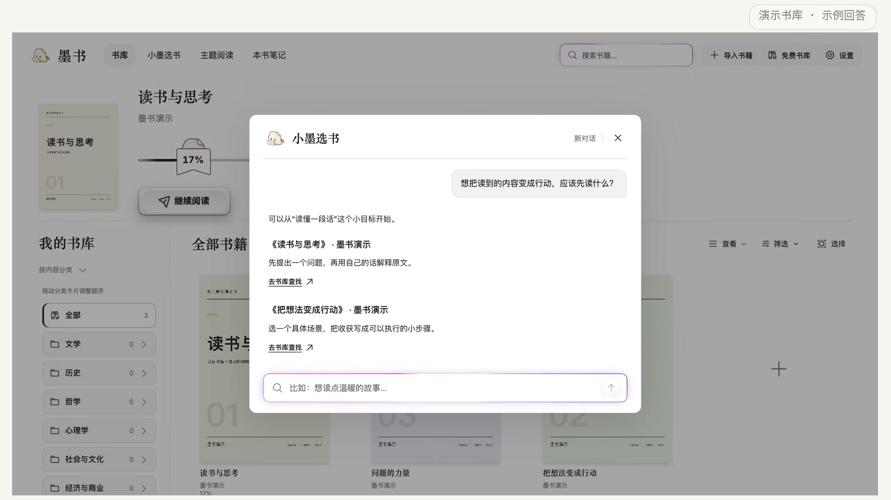
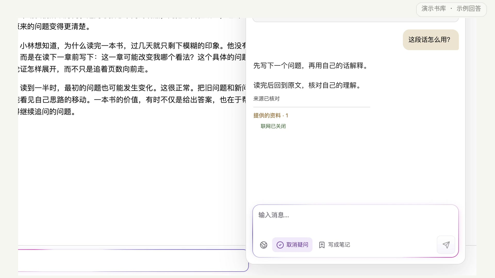

# 墨书

本地优先的 AI 阅读器。读原文、做笔记，也可以围绕一本书或多本书和 AI 讨论。

## 下载墨书

**当前版本：0.1.45** · 下载后直接安装，无需配置开发环境。

| 你的电脑 | 点击下载 |
| --- | --- |
| **Mac · Apple 芯片**（M1 / M2 / M3 / M4 等），macOS 12 或更新版本 | [**⬇ 下载 Mac 安装包（DMG）**](https://github.com/Az516/moshu-reader/releases/download/v0.1.45/Moshu_0.1.45_macOS_arm64.dmg) |
| **Windows · Intel / AMD 64 位**，Windows 10 / 11 | [**⬇ 下载 Windows 安装包（EXE）**](https://github.com/Az516/moshu-reader/releases/download/v0.1.45/Moshu_0.1.45_Windows_x64_setup.exe) |

[安装与首次使用](docs/moshu/install.md) · [版本说明与全部下载](https://github.com/Az516/moshu-reader/releases/tag/v0.1.45)

## 可以怎么用

- **快速阅读**：先浏览全书，找到值得细读的部分。
- **分析阅读**：阅读原文，选文提问，记录自己的理解和疑问。
- **主题阅读**：围绕同一个问题，结合多本书讨论并核对引用来源。
- **本书笔记**：整理笔记、疑问和方法论，回看原文与阅读成果。

支持 EPUB、目录、阅读进度、字体与背景调整、朗读和书库备份。基础阅读和笔记可以离线使用；使用 AI 时，需要在应用中配置自己的模型连接。

书籍、笔记、阅读进度和对话保存在自己的电脑上。使用 AI 时，会按当前功能向你配置的服务发送问题和必要的相关内容。

## 界面预览

以下界面来自隔离演示书库，AI 内容为示例回答。

查看原文讨论细节

## 源码与许可

墨书基于 [Readest](https://github.com/readest/readest) 开发，保留上游署名并遵循 [AGPL-3.0](LICENSE)。第三方组件继续使用各自的许可证。

[下载 0.1.45 对应的完整源码与构建说明](https://github.com/Az516/moshu-reader/releases/download/v0.1.45/Moshu_0.1.45_source.tar.gz)。安装和使用软件只需下载上面的 DMG 或 EXE。

开发与项目资料

发布安装包对应的源码以每个 Release 提供的完整源码归档为准。仓库默认分支目前保留较早的开发源码；GitHub 自动生成的 “Source code (zip / tar.gz)” 不代表本次安装包的完整构建输入，请使用上面的 `Moshu_0.1.45_source.tar.gz`。

- [使用与开发说明](README-Active-Reader.md)
- [设计方案与迭代资料](docs/moshu/README.md)
- [上游 Readest 说明](README-Upstream.md)

源码归档中的 `BUILD.md` 提供对应版本的构建步骤。开发需要 Node.js、pnpm、Rust 及目标平台工具链；正常安装使用不需要这些工具。

